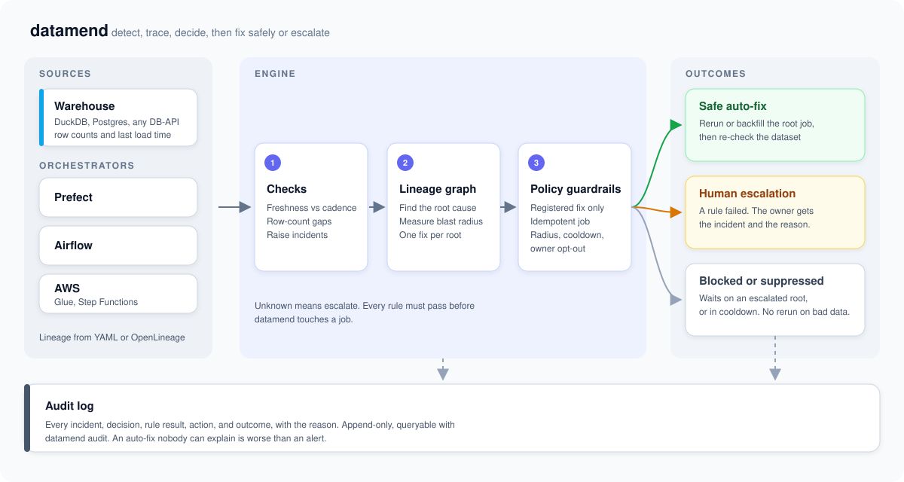

# datamend

[](https://github.com/saeed1507100/datamend/actions/workflows/ci.yml)

**Fix the data incidents that are safe to fix. Escalate the rest. Log every decision.**

Live replay of a real run: [datamend.saeedkhan.dev](https://datamend.saeedkhan.dev)

## The problem

If you run a few hundred datasets, you know these:

- **Stale and broken datasets go unnoticed.** A table stops loading, and you
  find out when a stakeholder asks why the dashboard is wrong.
- **Alerts are noise.** One failed upstream turns ten downstream tables red.
  You get ten pages for one root cause, and none of them tell you what to do.
- **On-call reruns make things worse.** You rerun the failed job at 3 a.m. The
  job appends instead of overwriting, so now revenue is doubled.

Most incidents are routine: a job needs a rerun, or a gap needs a backfill.
Some are not, and a blind rerun corrupts data. datamend tells the two apart
before it acts.

## How it works

<p align="center">
  
</p>

1. **Checks.** datamend compares each dataset's last load with its declared
   cadence and checks row counts for gaps. A failure becomes an incident.
2. **Lineage root cause and blast radius.** Datasets form a directed graph.
   datamend walks it to find the furthest-upstream failure and everything
   downstream of it. You get one incident per root, not one per red table.
3. **Guardrail policy.** An auto-fix runs only when every rule passes:

   | Rule | Why |
   | --- | --- |
   | The incident type has a registered fix (`stale` → rerun, `gap` → backfill) | No improvised fixes |
   | The job is declared idempotent | A rerun must not duplicate data |
   | The blast radius is under the limit | Wide impact needs a person |
   | The fix hasn't run within the cooldown window | Stops retry loops |
   | The dataset isn't tagged `critical: manual` | Owners can opt out |

4. **Safe auto-fix or human escalation.** If all rules pass, datamend reruns or
   backfills the root job and checks the dataset again. If any rule fails, the
   incident goes to a person with the failed rule as the reason. Datasets that
   wait on an escalated root are marked `blocked` and never rerun on bad data.
5. **Audit.** datamend records every incident, decision, rule result, action,
   and outcome. `datamend audit` shows what happened and why.

```json
{"incident": "orders:stale", "decision": "auto_fix", "action": "rerun:load_orders",
 "blast_radius": 3, "rules_passed": 5, "result": "fresh", "at": "2026-10-24T10:42:11Z"}
```

## Proof

These numbers come from real runs, not mock-ups. Details are in
[docs/LOG.md](docs/LOG.md).

- `make demo` breaks 3 datasets. datamend fixes 2 (`raw_orders` by rerun,
  `raw_customers` by backfill) and escalates `raw_payments`, because its job
  appends a full export and a rerun would double payments. Its downstream
  datasets are logged as `blocked`.
- A failed Prefect flow run (`ValueError` on `'$2,369.53'`) went from failure to
  a reviewed fix in 12 turns, 39 s, and $0.09. Production stayed at 45 rows,
  and the throwaway shadow schemas were dropped.
- The result is [pull request #1 on datamend-prefect-demo](https://github.com/saeed1507100/datamend-prefect-demo/pull/1).
  The first attempt broke the repo's own test. Validation caught it, and the
  second attempt passed. datamend opened the PR and stopped there; merging is
  a human decision.
- The test suite has 45 tests, and CI is green.

## Quickstart

You need Python 3.12 and [`uv`](https://docs.astral.sh/uv/).

```bash
git clone https://github.com/saeed1507100/datamend.git
cd datamend
make demo      # seed a synthetic warehouse, break 3 datasets, run one cycle
make demo-ai   # replay a recorded fix proposal for the escalated incident, approve it, re-check
```

`make demo-ai` replays a recorded run, so it needs no API key or network.

Step by step:

```bash
uv sync
uv run datamend seed                       # synthetic warehouse and catalog
uv run datamend inject stale raw_orders    # break something
uv run datamend inject gap raw_customers   # drop rows
uv run datamend run                        # check, decide, fix or escalate
uv run datamend audit                      # what happened and why
uv run datamend lineage raw_orders         # blast radius
uv run datamend lineage --mermaid          # whole graph, colored by state
uv run datamend serve                      # read-only page at 127.0.0.1:8000
```

## Adapters

datamend needs two things from your platform: a `Warehouse` that reports row
counts and last load time, and an `Orchestrator` that runs a job in `rerun` or
`backfill` mode. You choose them in the `platform:` block of `datasets.yaml`.

| Type | Kind | Notes |
| --- | --- | --- |
| `duckdb` | Warehouse | Default for the demo |
| `postgres` | Warehouse | Any DB-API driver. `uv sync --extra postgres` |
| `local` | Orchestrator | Python files with `run(con, now, mode)` |
| `airflow` | Orchestrator | DAG id; `mode` goes in the run `conf`. Airflow 2 and 3 |
| `prefect` | Orchestrator | `<flow>/<deployment>`; `mode` is a flow parameter |
| `aws_glue` | Orchestrator | `mode` is passed as `--mode`. `uv sync --extra aws` |
| `aws_stepfunctions` | Orchestrator | State machine name |

Lineage comes from `datasets.yaml` or from OpenLineage run events
(`--events events.jsonl`). Configuration examples:
[docs/ADAPTERS.md](docs/ADAPTERS.md).

```yaml
platform:
  warehouse:    {type: postgres, dsn_env: WAREHOUSE_DSN}
  orchestrator: {type: airflow, url: https://airflow.internal, token_env: AIRFLOW_TOKEN}
```

## Optional: fix proposals by pull request

When an incident escalates because the job itself is wrong, a person still has
to fix the code. datamend can help with that step, and it only ever proposes.

`datamend ai investigate` hands the escalated incident to a coding model in a
sandbox copy of the pipeline. Its patch must pass static guardrails (one file,
small diff, allowlisted imports, literal SQL with no DDL) and a shadow
validation: reruns and backfills change nothing, ids stay unique, and schema,
volume, and downstream checks hold. A person then approves it with
`datamend ai approve`. See [docs/AI.md](docs/AI.md).

`datamend watch prefect` does the same for remote pipelines. It reads failed
Prefect runs, reproduces each one against a throwaway schema, validates the
fix, compares it with production, and opens a pull request with the evidence.
It never merges and never writes to production. The pipeline repo declares how
to redirect its writes in `datamend.yaml`. See [docs/REMOTE.md](docs/REMOTE.md).

## Repo layout

```
datamend/
├── catalog.py      # load and validate datasets.yaml
├── checks.py       # freshness and row-count checks → incidents
├── lineage.py      # graph, root cause, blast radius
├── policy.py       # guardrail rules → auto_fix or needs_approval
├── actions.py      # registered fixes: rerun, backfill
├── engine.py       # one cycle: check → dedupe by root → decide → act → audit
├── audit.py        # append-only audit log
├── openlineage.py  # lineage from OpenLineage events
├── adapters/       # warehouses and orchestrators
├── ai/             # optional fix proposals: guardrails, validation, approval
├── remote/         # Prefect watcher: reproduce, validate, open a PR
└── cli.py          # the datamend command
examples/           # demo catalog, pipelines, recorded runs
site/               # static showcase that replays a real run
tests/              # pytest suite
docs/               # design notes and the project log
```

## Docs

- [docs/LOG.md](docs/LOG.md): what exists, how it got here, and what's next.
- [docs/ADAPTERS.md](docs/ADAPTERS.md): plug datamend into your warehouse and orchestrator.
- [docs/AI.md](docs/AI.md): fix proposals, guardrails, and the approval step.
- [docs/REMOTE.md](docs/REMOTE.md): the Prefect watcher and shadow mode.
- [docs/PLAN.md](docs/PLAN.md): original design and core types.
- [docs/DEPLOY.md](docs/DEPLOY.md): how the showcase site is deployed.

## Design decisions

- **A graph, not a dependency list.** Blast radius and cascading staleness both
  need traversal.
- **Fix the root, not the symptom.** datamend fixes only the furthest-upstream
  failure.
- **Never paper over an escalation.** A dataset that waits on an escalated root
  is `blocked`, even if its other roots were fixed.
- **Allowlist, not denylist.** datamend does only what is registered as safe.
  Unknown means escalate.
- **Audit everything.** An auto-fix nobody can explain is worse than an alert.

## Background

The approach comes from a system I built and ran on about 1,250 production
datasets, where freshness and lineage visibility also helped cut storage cost
by about 93% by retiring unused data safely. This repo is a from-scratch
reimplementation on synthetic data. It contains no proprietary code, data, or
company details.

## License

MIT
